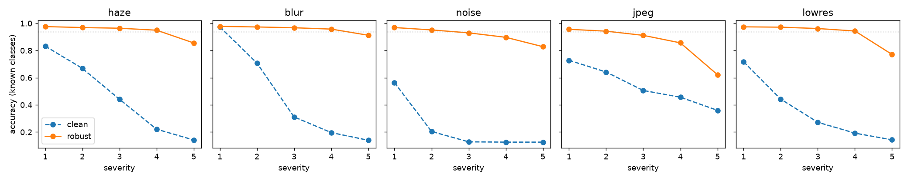
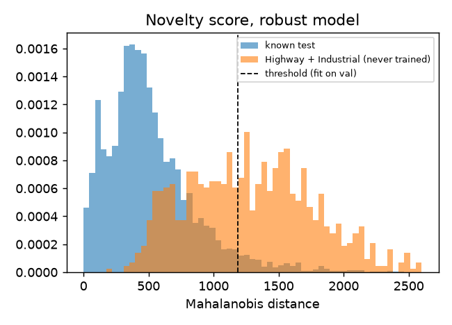

# geoint-triage

**Satellite-image triage that knows when to hand off to a human analyst, with an MCP tool layer and a local LLM agent on top.**

An imagery feed produces far more chips than analysts can look at. A classifier can label the routine ones, but in a
mission setting the expensive failures are the quiet ones: a model that confidently labels something it has never
seen, or one that silently degrades when the weather, the sensor or the downlink changes. This repo builds the
whole loop and measures each of those failure modes:

1. **Train** a PyTorch ResNet-18 on EuroSAT (Sentinel-2 RGB, 64×64 chips) for 8 land-use classes, against a
   scikit-learn gradient-boosting baseline on hand-built spectral/texture features.
2. **Hold out two classes entirely** (Highway, Industrial) as stand-ins for *new activity* the model was never trained on.
3. **Stress-test** the model under five synthetic collection degradations (haze/thin cloud, blur, sensor noise, JPEG
   on a constrained link, coarser resolution) and train a degradation-augmented variant.
4. **Route** every chip: auto-accept, or send to an analyst because it is *novel* (Mahalanobis distance in embedding
   space) or *low confidence* (temperature-scaled probability). All thresholds are fit on known-class validation data only.
5. **Group** what was flagged with unsupervised clustering, so an analyst labels a cluster instead of 400 single chips.
6. **Monitor** batches for drift (kernel MMD permutation test on embeddings).
7. **Deploy** as an ONNX Runtime service (FastAPI, Docker, no PyTorch in the image) and as an **MCP server**, then
   drive it with a **LangGraph agent** running a local open-weights LLM, benchmarked on 28 analyst questions.

Everything runs offline on a laptop (Apple M4, 16 GB): no API keys, no cloud. Training takes about 7 minutes per model.

---

## Results

Test split: 4,403 known-class chips + 997 chips from the two never-trained classes. Numbers are from `reports/results.json`.

### Classification, calibration and robustness

| | known-class acc | macro-F1 | ECE raw → temp-scaled | mean acc over 25 degradation settings |
|---|---|---|---|---|
| scikit-learn HGB on spectral/texture features | 93.8 % | 0.935 | – | 26–66 % at severity 3 |
| ResNet-18, clean training | **98.6 %** | 0.986 | 4.3 % → 0.6 % | 41 % |
| ResNet-18, degradation-augmented (**deployed**) | 97.9 % | 0.979 | 4.3 % → **0.4 %** | **92 %** |



The clean model is the best on clean imagery and falls apart off-distribution: severity-3 haze drops it to 44 %,
sensor noise to 13 %. Augmenting training with the same degradation family costs 0.7 points of clean accuracy and
holds 91–97 % at severity 3. That trade is why the augmented model is the one deployed.

### Spotting what it was never trained on

AUROC for separating known test chips from Highway/Industrial chips (higher is better), and the false-alarm rate on
known chips at the threshold that catches 95 % of novel ones:

| score | clean AUROC | robust AUROC | robust FPR @ 95 % TPR |
|---|---|---|---|
| max softmax probability | 0.807 | 0.834 | 81 % |
| energy | 0.656 | 0.742 | 84 % |
| kNN distance (k=10) | 0.907 | 0.885 | 54 % |
| **Mahalanobis** (used by the service) | **0.936** | **0.912** | 35 % |
| relative Mahalanobis | 0.939 | 0.921 | 33 % |



Softmax confidence is a poor novelty signal here: the model is *confidently wrong* on never-seen chips. It calls
62 % of Highway chips River and most Industrial chips Residential or PermanentCrop, and about two-thirds of novel
chips get over 90 % confidence. Embedding-space distance works far better. Mahalanobis was chosen as the
routing score before the held-out classes were scored. Relative Mahalanobis came out marginally better and is
reported, not swapped in after the fact.

### The routing policy on a mixed feed

Auto-labeling everything with the argmax gets 20 % of the mixed feed wrong, because every novel chip is a guaranteed
error. With routing (robust model), and the novelty threshold set to flag a fixed share of *known* validation chips:

| novelty false-alarm budget | chips auto-labeled | error among auto-labeled | novel chips sent to analyst | known chips auto-labeled (acc) |
|---|---|---|---|---|
| 2 % | 88 % | 12.4 % | 45 % | 95 % (99.1 %) |
| **5 %** (service default) | 84 % | 9.8 % | 60 % | 94 % (99.0 %) |
| 10 % | 77 % | 7.1 % | 74 % | 89 % (99.1 %) |
| 20 % | 68 % | 4.9 % | 85 % | 80 % (99.1 %) |

**Known-class chips that are auto-labeled are 99 % correct at every setting.** The residual error is almost all novel
content slipping through, so where to set the threshold is a staffing decision (analyst hours vs. missed new
activity), and the table is what that decision should be made from. This is the weakest part of the system and the
first thing to improve (see *Next steps*).

### Unsupervised: grouping the analyst queue

K-means on the PCA-reduced embeddings of the 772 chips the robust model flagged as novel (73 % of them truly novel),
with k picked by silhouette, finds two clusters: one 76 % Industrial and one 55 % Highway (NMI 0.37). The clean
model's queue splits into six clusters, two of them 77–88 % pure. The analyst gets a handful of groups to name
instead of hundreds of chips, though the groups are not clean enough to auto-label.

### Drift monitoring

Alarm rate over 20 batches of 200 chips each (MMD permutation test, α = 0.05):

| batch | clean model | robust model |
|---|---|---|
| no shift | 5 % | **0 %** |
| haze, severity 2 | 100 % | 60 % |
| JPEG, severity 3 | 100 % | 100 % |
| 20 % novel content | 85 % | 70 % |
| class-mix shift (water/forest only) | 100 % | 100 % |

The robust model is *meant* to be invariant to haze, so its embedding moves less and the drift test fires less. That is
consistent with its accuracy barely moving under haze, but it means the drift monitor should also watch an
image-statistics channel, not only embeddings, if you need to know *that* the weather changed.

### Agent: does it relay tool output faithfully?

The LangGraph agent talks to the MCP server over stdio, the same way Claude Desktop or Cursor would. The benchmark is
28 analyst questions ("How many chips in passC need an analyst?", "Is there drift in passD?", "Chip passC-031 was
flagged; what is it similar to?"). Expected answers come from calling the engine directly, so this scores the
*agent*, not the classifier.

| local model | right tool + args | correct answer | numbers grounded in tool output | tool errors | sec / question (M4) |
|---|---|---|---|---|---|
| Qwen2.5-0.5B-Instruct | 64 % | 54 % | 89 % | 8 | 2.7 |
| Qwen2.5-1.5B-Instruct | 86 % | 82 % | 100 % | 0 | 7.4 |
| Qwen2.5-3B-Instruct | **96 %** | **89 %** | 100 % | 1 | 13.7 |

Model size matters more than anything else in the agent loop: 0.5B picks the wrong tool or passes bad arguments a
third of the time, while 3B is close to reliable at about twice the latency of 1.5B. The failures are instructive. The 1.5B model's misses are mostly *not calling the tool*: for "which class was
auto-labeled most in passA" it called `list_passes` only and then answered "water", which isn't a class. Its numbers
are always copied correctly, but it sometimes misreads them, for example saying a novelty score of 347 "exceeds" a
threshold of 1187. The numeric grounding check can't catch that kind of error, which is why this agent sits
**behind** the triage engine and never overrides its routing decision.

### Demo feed

`samples/feed/` holds four 60-chip "collection passes" built from the test split: routine (A), hazy (B),
12 never-trained chips mixed in (C), and heavily compressed (D). Against the hidden ground truth in
`samples/feed_truth.json`:

| pass | flagged novel | truly novel caught | auto-labeled | auto-label accuracy | drift alarm |
|---|---|---|---|---|---|
| A routine | 2 | – | 55 | 98 % | no |
| B haze | 16 | – | 44 | 100 % | no |
| C new activity | 9 | 7 of 12 | 51 | 90 % | no |
| D compression | 23 | – | 33 | 94 % | **yes** (p = 0.005) |

Degraded passes push chips to analysts, which is the safe direction, but it costs analyst time.

---

## Run it

```bash
python -m venv .venv && .venv/bin/pip install -r requirements.txt
make data train eval export feed test     # ~25 min on an M-series Mac; CPU works, slower
make serve                                 # http://localhost:8080/docs
make agent-eval                            # downloads Qwen2.5 0.5B/1.5B/3B from Hugging Face
.venv/bin/python -m geoint.agent "Which pass has the most chips flagged as novel?"
```

The trained ONNX model, embedding bank and policy are committed in `artifacts/`, so `make serve`, the MCP server and
the tests work straight from a clone without training.

**REST API**

```bash
curl -F files=@samples/feed/passC/passC-000.png localhost:8080/classify
# {"results":[{"label":"Pasture","confidence":0.9929,"top3":[...],"novelty_score":616.44,
#              "novelty_threshold":1187.47,"route":"auto","reason":"auto"}]}
```

`POST /drift` (≥ 30 chips), `GET /health`, `GET /metrics` (Prometheus text).

**MCP server** (tools: `list_passes`, `triage_pass`, `classify_chip`, `find_similar`, `drift_check`). To use it
from Claude Desktop or Cursor:

```json
{"mcpServers": {"geoint-triage": {"command": "/path/to/geoint-triage/.venv/bin/python",
                                   "args": ["-m", "geoint.mcp_server"],
                                   "cwd": "/path/to/geoint-triage"}}}
```

**Docker** (ONNX Runtime only, non-root, ~45 MB model baked in): `docker build -t geoint-triage . && docker run -p 8080:8080 geoint-triage`.
CI builds the image and smoke-tests `/classify` on every push.

## Layout

```
geoint/
  data.py        EuroSAT loading, known/novel split (numpy only)
  degrade.py     5 collection degradations × 5 severities + training augmentation
  model.py       ResNet-18 adapted to 64×64, exposes the 512-d embedding
  features.py    hand-built features for the scikit-learn baseline
  calibrate.py   temperature scaling, ECE, risk-coverage, risk-targeted threshold
  novelty.py     MSP, energy, Mahalanobis, relative Mahalanobis, kNN
  triage.py      routing policy (fit on known validation only) + summary metrics
  drift.py       kernel MMD permutation test, PSI
  engine.py      TriageEngine: ONNX + bank + policy; shared by API, MCP and tests
  mcp_server.py  MCP tools
  agent.py       LangGraph agent, local Qwen via transformers, MCP client over stdio
scripts/         train, evaluate, export_onnx, make_feed, eval_agent
serve/app.py     FastAPI
tests/           20 tests: unit math, API contract, ONNX↔PyTorch parity, path traversal, MCP round-trip
```

## Limitations

- **Civilian, low-resolution data.** EuroSAT is 10 m Sentinel-2 RGB land use. It shows the method, not mission
  performance: real ISR imagery is higher-resolution, multi-sensor (EO/IR/SAR), and object-centric.
- **Synthetic degradations.** Haze, noise and compression are simulated per chip, not taken from real collection
  conditions. The robust model was trained and tested on the same degradation family, so the 92 % figure is an upper
  bound for degradations of a kind it hasn't seen.
- **"Novel" is a proxy.** The two held-out classes are only one kind of novelty. Real new activity inside a known class
  (new construction inside a residential area) is subtler and harder to catch.
- **Small agent benchmark.** 28 questions with string-match scoring. It measures whether tool output is relayed
  faithfully, not whether the answer is useful to an analyst.
- **Single training seed**; no confidence intervals on the classifier metrics.

## Next steps

- Improve novelty recall at a fixed false-alarm rate: multi-layer Mahalanobis features, outlier exposure on unlabeled
  imagery, or a self-supervised backbone (DINOv2 / SatMAE) fine-tuned on unlabeled chips.
- Move to object detection (xView / DOTA) with the same route-to-analyst policy at the object level.
- Close the loop: analyst labels on a cluster → incremental class added → policy refit, with drift checks gating each
  release.
- A semantic consistency check on the agent (does the answer's claim match the tool's `route`/`reason` field?) to catch
  misreadings like the 347-vs-1187 one, not just invented numbers.

Data: EuroSAT (Helber et al., 2019), MIT license, via `timm/eurosat-rgb` on Hugging Face.
